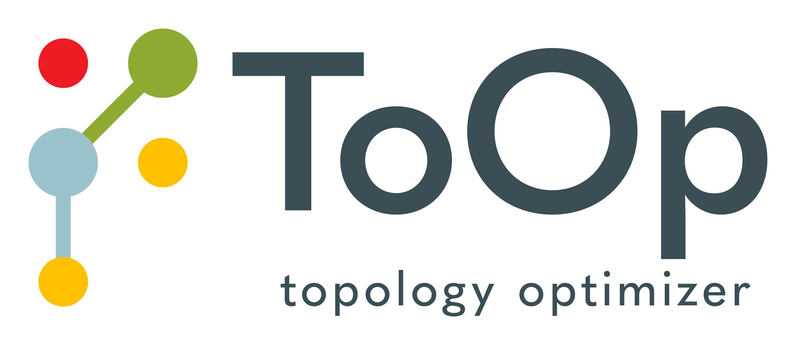
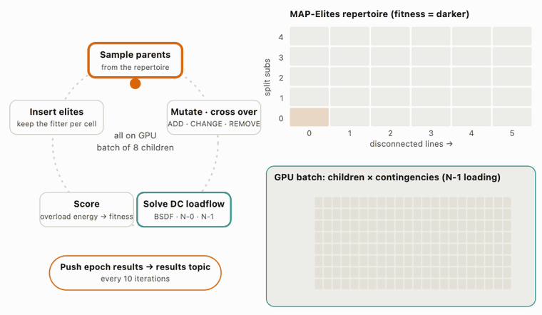
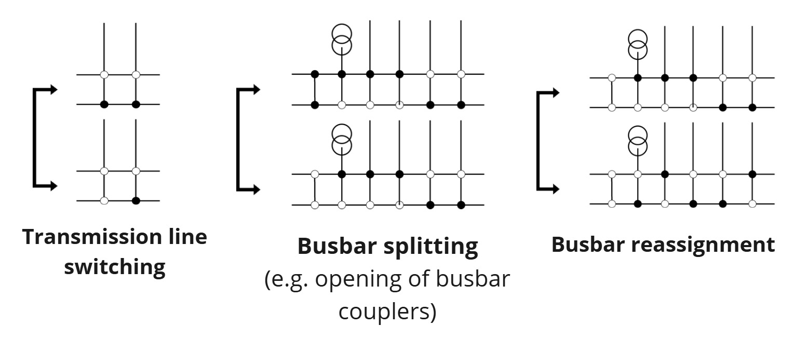

<p>
  <picture>
    <source media="(prefers-color-scheme: dark)" srcset="./docs/assets/elia-group-logo.png">
    
  </picture>
  <picture>
    <source media="(prefers-color-scheme: dark)" srcset="./docs/assets/toop-logo-white.png">
    
  </picture>
</p>

# Topology optimization for power grids, on the GPU

<!-- markdown-link-check-disable -->
<p align="center">
  <a href="https://eliagroup.github.io/ToOp/latest/tour/"></a>
  <br>
  <a href="https://eliagroup.github.io/ToOp/latest/tour/"></a>
</p>
<!-- markdown-link-check-enable -->

<!-- markdown-link-check-disable -->
[](https://github.com/eliagroup/ToOp/actions/workflows/ci.yaml)
[](https://scorecard.dev/viewer/?uri=github.com/eliagroup/ToOp)
[](https://sonarqube.consumercentricity.io/dashboard?id=gras-gridanalysis-toop-engine)
[](https://sonarqube.consumercentricity.io/dashboard?id=gras-gridanalysis-toop-engine)
[](https://sonarqube.consumercentricity.io/dashboard?id=gras-gridanalysis-toop-engine)
[](https://opensource.org/licenses/MPL-2.0)
[](https://www.python.org/downloads/release/python-3140/)

[**Interactive tour**](https://eliagroup.github.io/ToOp/latest/tour/)
| [**What is ToOp?**](#what-is-toop)
| [**Quick examples**](#quick-examples)
| [**How it works**](#how-it-works)
| [**Installation**](#installation)
| [**Documentation**](https://eliagroup.github.io/ToOp)
<!-- markdown-link-check-enable -->

## What is ToOp?

Electricity does not take the route we pick for it. It spreads over every line it can reach, simply following the laws of physics. On busy days some of these lines end up carrying more power than they safely can – grid operators call this *congestion*. The usual fix is *redispatch*: asking one power plant to produce less and another, somewhere else, to produce more. It works, but it is expensive, and it often means starting up plants that emit more CO₂.

ToOp, short for *topology optimization*, looks for a cheaper and cleaner way out. Rather than changing who produces the electricity, it changes the layout of the grid itself – for example by switching off a line, or by splitting a substation so that it behaves like two separate junctions. Much like closing a street or opening a new junction in a city, these *topological actions* gently steer the power away from the lines that are full, and they cost next to nothing to carry out. ToOp searches through the many possible combinations and suggests the most promising ones to the operators in the control room, who always have the final say.

> Our goal: help grid operators relieve congestion with clever switching instead of costly redispatch – saving money and CO₂ along the way.

This repository holds the engine behind ToOp at Elia Group. It reads operational grid data through an importer, searches for good topologies in a fast DC optimization stage, and double-checks the best candidates with a full AC validation. It also contains the GPU-based DC load flow solver that makes the search fast. Today ToOp considers transmission line switching, busbar splitting, busbar reassignment and linear tap optimization of phase-shifting transformers (PSTs); for grids imported with PowSyBl, it can also optimize groups of PSTs together.



<!-- markdown-link-check-disable -->
Curious how it all fits together? The **[interactive tour](https://eliagroup.github.io/ToOp/latest/tour/)** walks you through a whole run – from the grid file to the proposals shown to the operator – with a small animated sketch for every component.
<!-- markdown-link-check-enable -->

### Contents

* [Quick examples](#quick-examples)
* [How it works](#how-it-works)
* [Installation](#installation)
* [Documentation and further reading](#documentation-and-further-reading)
* [Working together](#working-together)
* [Citing ToOp](#citing-toop)

## Quick examples

**A batched DC load flow in a few lines.** Write the IEEE 57-bus test grid to a folder, preprocess it for the GPU solver and compute the flow on every branch:

```python
from pathlib import Path

import jax
from fsspec.implementations.dirfs import DirFileSystem
from toop_engine_dc_solver.example_grids import case57_data_powsybl
from toop_engine_dc_solver.preprocess.convert_to_jax import load_grid, run_initial_loadflow

jax.config.update("jax_enable_x64", True)

folder = Path("data/case57")
case57_data_powsybl(folder)  # write the example grid
stats, static_information, network_data = load_grid(DirFileSystem(str(folder)))

static_information, metrics = run_initial_loadflow(static_information)
print(static_information.dynamic_information.unsplit_flow.shape)  # (timesteps, branches) -> (1, 82)
```

**The whole pipeline: import, optimize, validate.** The example notebooks walk you through it step by step and are the best place to continue:

| Notebook | What it shows |
| --- | --- |
| [`example1_dc_loadflow_example`](./notebooks/example1_dc_loadflow_example.ipynb) | the DC load flow above, with more detail |
| [`example2_small_grid_toop`](./notebooks/example2_small_grid_toop.ipynb) | optimizing a small node-breaker grid and looking at the changed substation |
| [`example3_e2e_pipeline`](./notebooks/example3_e2e_pipeline.ipynb) | the whole pipeline on any PyPowSyBl-compatible grid file |
| [`example4_data_contracts`](./notebooks/example4_data_contracts.ipynb) | the same journey with the packages called directly, so every hand-over is visible |
| [`example5_e2e_ac_validation`](./notebooks/example5_e2e_ac_validation.ipynb) | the whole pipeline called by hand, AC-validated end to end |

<!-- markdown-link-check-disable -->
To see how the stages of a run fit together, take the **[interactive tour](https://eliagroup.github.io/ToOp/latest/tour/)**.
<!-- markdown-link-check-enable -->

## How it works

A ToOp run passes through three stages, each a worker that can run on its own:

1. **Importer** – reads a UCTE or CGMES grid, builds the masks and the N-1 definition, and prepares everything the GPU needs.
2. **DC-Optimizer** – a genetic, quality-diversity search on the GPU; every candidate topology is scored with a batched DC load flow.
3. **AC-Validator** – picks the most promising candidates and checks them with a full AC contingency analysis before they reach the operator.

<!-- markdown-link-check-disable -->
For a visual, step-by-step tour of this pipeline – what every component does and which package implements it – take the **[interactive tour](https://eliagroup.github.io/ToOp/latest/tour/)** (or open `docs/tour/index.html` locally in your browser). The C4 architecture model lives in [`docs/architecture`](./docs/architecture/README.md).
<!-- markdown-link-check-enable -->

ToOp ships no GUI or system integration: you drive it from Python or through Kafka commands.

## Installation

ToOp is not published on PyPI yet. Clone the repository and install it with [`uv`](https://docs.astral.sh/uv/getting-started/installation/):

```bash
git clone https://github.com/eliagroup/ToOp.git
cd ToOp
uv sync --all-groups
```

To run on an NVIDIA GPU, add JAX with CUDA support:

```bash
uv pip install "jax[cuda12]"
```

If you would like to contribute, we recommend the VS Code devcontainer, so everyone develops in the same environment. The [contribution guide](./docs/contribution_guide.md#local-development-setup) walks you through the setup.

## Documentation and further reading

<!-- markdown-link-check-disable -->
The full documentation lives at **[eliagroup.github.io/ToOp](https://eliagroup.github.io/ToOp)**. To read it locally, run `uv run mkdocs serve`.
<!-- markdown-link-check-enable -->

* [Quickstart](./docs/quickstart.md) – the basics, with examples to follow along
* [Usage](./docs/usage.md) – the two ways to use ToOp: from Python or through Kafka
* [Topology optimizer](./docs/topology_optimizer/intro.md) – the ideas behind the optimizer
* [DC solver](./docs/dc_solver/intro.md) – the GPU load flow solver and the batch dimensions it supports
* Talks at LF Energy: [2025](https://www.youtube.com/watch?v=XteDpNsX75A) and [2024](https://lfenergy.org/lf-energy-summit-recap-and-video-a-gpu-native-approach-on-tackling-grid-topology-optimization/)

## Working together

We believe topology optimization works best when it is developed jointly and applied to the grid as a whole, taking into account the operational constraints of different TSOs. So please try ToOp, ask questions, share your feedback and your constraints – and if you like it, contribute. We would also love to hear your ideas for combining ToOp with other open-source tools.

* **Contributing:** have a look at our [contribution guide](./docs/contribution_guide.md).
* **Roadmap:** current work broadens the supported controllable assets, improves preprocessing fidelity and hardens the end-to-end workflow. A more high-level roadmap will follow.
* **Contact:** do not hesitate to reach out if you are interested in the project or need help with the setup. Your first point of contact is <a href="mailto:ToOp@eliagroup.eu">ToOp@eliagroup.eu</a>.

## Citing ToOp

If you use our work in scientific research, please cite [our paper on load flow solving](https://arxiv.org/abs/2501.17529). The paper on the optimizer architecture will follow soon.

ToOp builds on JAX, and we gladly credit its authors:

```
@software{jax2018github,
  author = {James Bradbury and Roy Frostig and Peter Hawkins and Matthew James Johnson and Chris Leary and Dougal Maclaurin and George Necula and Adam Paszke and Jake Vander{P}las and Skye Wanderman-{M}ilne and Qiao Zhang},
  title = {{JAX}: composable transformations of {P}ython+{N}um{P}y programs},
  url = {http://github.com/jax-ml/jax},
  version = {0.3.13},
  year = {2018},
}
```

## License

<!-- markdown-link-check-disable -->
Distributed under MPL 2.0. See [LICENSE](./LICENSE).
<!-- markdown-link-check-enable -->
