# Cascade Simulation

After each converged contingency load flow, an optional cascade simulation can be
enabled via `CascadeConfig`.
It models how a single outage can trigger a chain of further trips through distance
protection or current overload.

## How it works

Each call to `run_single_outage` follows this pipeline:

```mermaid
flowchart TD
    INPUT(["⚡ run_single_outage<br/>─────────────────<br/>net · contingency · ctx"])

    subgraph PF["① INITIAL POWER FLOW"]
        direction LR
        OUTAGE["Disconnect<br/>Outaged Elements"]
        SPPS["SpPS<br/>Iteration"]
        LF["pandapower<br/>runpp"]
        OUTAGE --> SPPS --> LF
    end

    subgraph RESULTS["② COLLECT RESULTS"]
        direction LR
        BR["Branch Results<br/>loading · power · per-side"]
        NR["Node Results<br/>voltages"]
        SR["Switch Results<br/>bus-side oriented"]
        RR["Regulating<br/>Element Results"]

        BR ~~~ NR
        NR ~~~ SR
        SR ~~~ RR
    end

    subgraph META["③ METADATA TABLES"]
        direction LR
        SPPSRES["SpPS Results<br/>schemes · iterations"]
        CONV["Convergence<br/>converged / failed"]

        SPPSRES ~~~ CONV
    end

    subgraph CASCADE["④ CASCADE SIMULATION ── NEW"]
        direction TB

        GUARD{"Load flow<br/>converged?<br/>+<br/>CascadeConfig<br/>present?"}

        subgraph CTX["Build Context"]
            BCTX["Relay data<br/>+ Network topology<br/>+ Breaker map"]
        end

        subgraph DETECT["Detect Triggers"]
            DT["Distance Protection<br/>Impedance vs. polygon zones<br/>⚠ WARNING 🟠 ALARM 🔴 DANGER"]
            OL["Current Overload<br/>loading% vs. threshold"]
        end

        EMPTY(["∅ No cascade"])

        subgraph LOOP["Cascade Loop ── up to depth_limit steps"]
            direction TB

            L1["Map triggers → Outage Groups<br/>relay protected elements · connected components"]
            L2["Generate CascadeEvents<br/>element · reason · loading · impedance"]
            L3["Re-run SpPS + Load Flow<br/>(accumulated outages)"]
            L4["Attach SpPS activation info"]
            L5{"More<br/>triggers?"}
            L6{"Load flow<br/>converged?"}
            FAIL(["Failure Event<br/>→ stop"])

            L1 --> L2 --> L3 --> L4 --> L5
            L5 -->|yes| L6
            L6 -->|no| FAIL
            L6 -->|yes| L1
        end

        TABLE["Build Cascade Results"]

        GUARD -->|no| EMPTY
        GUARD -->|yes| CTX
        CTX --> DETECT
        DETECT -->|no triggers| EMPTY
        DETECT -->|triggers found| L1
        L5 -->|no| TABLE
        FAIL --> TABLE
        EMPTY --> TABLE
    end

    OUTPUT(["📦 Build LoadflowResults"])

    INPUT --> PF
    PF --> RESULTS
    RESULTS --> META
    META --> CASCADE
    CASCADE --> OUTPUT

    style INPUT fill:#dcfce7,stroke:#10b981,color:#064e3b
    style OUTPUT fill:#ede9fe,stroke:#7c3aed,color:#1e1b4b

    style PF fill:#ecfdf5,stroke:#10b981,color:#064e3b
    style RESULTS fill:#ecfdf5,stroke:#10b981,color:#064e3b
    style META fill:#f3f4f6,stroke:#6b7280,color:#374151

    style CASCADE fill:#f8fafc,stroke:#7c3aed,color:#0f172a
    style CTX fill:#f3f4f6,stroke:#6b7280,color:#374151
    style DETECT fill:#fffbeb,stroke:#f59e0b,color:#92400e
    style LOOP fill:#eff6ff,stroke:#3b82f6,color:#1e3a5f

    style EMPTY fill:#f3f4f6,stroke:#6b7280,color:#374151
    style FAIL fill:#fee2e2,stroke:#ef4444,color:#7f1d1d
    style TABLE fill:#dbeafe,stroke:#3b82f6,color:#1e3a5f

    style GUARD fill:#fef3c7,stroke:#f59e0b,color:#92400e
    style L5 fill:#fef3c7,stroke:#f59e0b,color:#92400e
    style L6 fill:#fee2e2,stroke:#ef4444,color:#7f1d1d
```



## Trigger types

| Type | Detection | Threshold |
|---|---|---|
| **Current overload** | Branch loading exceeds the threshold resolved for its element type and case | Configurable per `CascadeConfig` |
| **Distance protection** | Relay impedance falls inside any of the three polygon zones | Defined per relay in the [relay table](#relay-input-relayschema) |

### Current overload thresholds

`loading` is the per-unit ratio `i / i_max`, so `1.5` means 150 %. The comparison is
strict: a branch loaded at exactly its threshold does **not** trip.

Each branch result row gets its own threshold, resolved from the element type
(`line`, transformer, or anything else) and from whether the row belongs to the base
case or to a contingency:

These live on `CascadeConfig.overload`, an `OverloadConfig`:

| Row | Threshold | Falls back to |
|---|---|---|
| `line`, base case | `overload.basecase_line` | `overload.current_loading_threshold` |
| `line`, contingency | `overload.contingency_line` | `overload.basecase_line`, then `overload.current_loading_threshold` |
| `trafo` / `trafo3w`, base case | `overload.basecase_transformer` | `overload.current_loading_threshold` |
| `trafo` / `trafo3w`, contingency | `overload.contingency_transformer` | `overload.basecase_transformer`, then `overload.current_loading_threshold` |
| any other table (e.g. `impedance`) | `overload.current_loading_threshold` | — |

All four overrides are optional. When none of them are set, every branch is compared
against `current_loading_threshold`, exactly as before they existed.

Unlike the distance-protection factors, these keep their fallback chain: the scalar
`current_loading_threshold` is the value every row uses until a more specific one is set.

## Base-case screening

A base case that already violates makes every contingency cascade meaningless: the cascade
would start from an already-broken state, and practically every contingency would report one.

Before any contingency is computed, the solved N-0 network is therefore screened once with the
same overload and distance-protection detection the simulator uses. Any of the three zones
counts as a violation — each means the relay is already reading into its
protection characteristic in N-0.

When the base case violates:

- cascade simulation is skipped for **every** contingency;
- the violation is reported instead, as `cascade_results` rows under the `BASECASE`
  contingency with `cascade_number = 0`. They carry the ordinary `CURRENT_VIOLATION` /
  `DISTANCE_PROTECTION` reasons — the step number is what sets them apart, since simulated
  cascade events always start at step 1;
- a warning is added to `LoadflowResults.warnings`;
- the N-1 load flows themselves are **unaffected** — branch, node, switch and va-diff results
  are computed exactly as usual.

Screening is controlled by `stop_cascade_on_basecase_violation` (default `True`). Set it to
`False` to restore the previous behaviour and simulate the cascade even from a violating base
case — for example in tests that deliberately overload the base case to force a cascade.

The screen is skipped when the base-case load flow did not converge: its `res_*` tables are
stale, so there is nothing meaningful to check.

## Configuration

Cascade screening is opt-in. Pass a `CascadeConfig` instance when building the
analysis context:

```python
from toop_engine_contingency_analysis.pandapower.cascade.configuration import (
    CascadeConfig,
    DistanceProtectionConfig,
    DistanceProtectionFactors,
    OverloadConfig,
)

cascade_cfg = CascadeConfig(
    depth_limit=5,
    min_island_size=10,
    overload=OverloadConfig(current_loading_threshold=1.0),
    distance_protection=DistanceProtectionConfig(
        alarm=DistanceProtectionFactors(
                basecase_line=1.0,
            basecase_transformer=1.0,
            basecase_bus_coupler=1.0,
            contingency_line=1.0,
            contingency_transformer=1.0,
            contingency_bus_coupler=1.0,
        ),
        warning=DistanceProtectionFactors(
                basecase_line=1.41,
            basecase_transformer=1.41,
            basecase_bus_coupler=1.41,
            contingency_line=1.41,
            contingency_transformer=1.41,
            contingency_bus_coupler=1.41,
        ),
    ),
    cascade_log_elements=["line", "trafo", "trafo3w"],
    stop_cascade_on_basecase_violation=True,  # skip the cascade when N-0 already violates
)
```

To trip lines at 150 % and transformers at 180 % instead, add the per-type overrides
(see [Current overload thresholds](#current-overload-thresholds)):

```python
cascade_cfg = CascadeConfig(
    depth_limit=5,
    min_island_size=10,
    overload=OverloadConfig(
        current_loading_threshold=1.0,  # still used for e.g. impedances
        basecase_line=1.5,
        basecase_transformer=1.8,
    ),
    distance_protection=DistanceProtectionConfig(
        alarm=DistanceProtectionFactors(
                basecase_line=1.0,
            basecase_transformer=1.0,
            basecase_bus_coupler=1.0,
            contingency_line=1.0,
            contingency_transformer=1.0,
            contingency_bus_coupler=1.0,
        ),
        warning=DistanceProtectionFactors(
                basecase_line=1.41,
            basecase_transformer=1.41,
            basecase_bus_coupler=1.41,
            contingency_line=1.41,
            contingency_transformer=1.41,
            contingency_bus_coupler=1.41,
        ),
    ),
    cascade_log_elements=["line", "trafo", "trafo3w"],
)
```

### Distance protection factors

A factor divides the relay impedance measurement before the polygon test
(`x = |r_ohm| / factor`), so a larger factor moves the measured point toward the origin
and **widens** the effective area. `1.0` leaves the relay polygon exactly as the relay
defines it.

### The three zones

A measurement falls into one of three nested zones. `DistanceProtectionSeverity` names them,
innermost first:

| Zone | What it is | Configurable |
|---|---|---|
| `DANGER` | The relay polygon exactly as the relay defines it — the real trip boundary | **No.** No factor may widen it |
| `ALARM` | The ring just outside the danger polygon | `distance_protection.alarm` |
| `WARNING` | The outermost ring | `distance_protection.warning` |

They nest — danger inside alarm inside warning — which in factor terms means
`1.0 <= alarm <= warning` on each axis. Nothing enforces that: a narrower warning area still
works, because a relay inside its raw polygon trips on the danger zone regardless.

A relay trips when it is inside **any** zone; the severity recorded on the event is the
innermost zone it reached. So the warning factors are normally what decide *which* relays
trip, while the alarm factors only move the `ALARM`/`WARNING` labelling boundary.

`DistanceProtectionConfig` holds one `DistanceProtectionFactors` group per configurable zone,
and each group carries every case/element combination:

| | `line` | `transformer` | `bus_coupler` |
|---|---|---|---|
| **base case** | `basecase_line` | `basecase_transformer` | `basecase_bus_coupler` |
| **contingency** | `contingency_line` | `contingency_transformer` | `contingency_bus_coupler` |

Six per zone, so **twelve in total, all required** — none has a default and none falls back to
another. A configuration therefore always states the factor it wants on every axis, and a
caller written against an older release fails at construction instead of silently picking up
a default.

!!! note "The trip boundary is not configurable"
    The danger zone is the relay polygon untouched, so no setting here can make the
    simulation report a trip inside a boundary the physical relay would not cross. Only the
    two outer screening rings take factors.

A relay whose `protection_element` is `None` — it protects elements of more than one
type — takes **the largest of the three factors**, so an ambiguous relay is screened at least
as widely as any candidate would screen it.

When `cascade` is `None` in the context, the cascade step is skipped and
`LoadflowResults.cascade_results` is an empty DataFrame.

## Relay input: `RelaySchema`

Distance protection needs the relays, passed to the contingency analysis as their own table next
to the network — they are not attached to it:

```python
lf_results = run_contingency_analysis_pandapower(
    net=net,
    n_minus_1_definition=nminus1_def,
    job_id="job",
    timestep=0,
    cfg=cfg,
    relays=relays,  # pandas DataFrame validated against RelaySchema
)
```

Relays are separate from switches. A relay measures at a breaker, but one breaker can carry
several relays guarding different elements — a line relay and a transformer relay, say — and one
relay can guard several elements, such as two lines.

The table has one row per relay. `RelaySchema`
(`toop_engine_contingency_analysis.pandapower.cascade.configuration`) defines it, and every
column is required:

| Column | Type | Description |
|---|---|---|
| `relay_id` | `str` | ID of the relay. A relay on several breakers has a row per breaker with the same ID; a trip of any of them takes out the elements of all its rows |
| `relay_name` | `str` or `None` | Human-readable relay name, copied into the cascade results |
| `breaker_uuid` | `str` | The breaker the relay measures at; matched against `net.switch["origin_id"]`. Several relays may share one |
| `relay_side` | `str` | Side of the breaker the relay is on: `"bus"` or `"element"`. Switch results are measured from the bus side, so an `"element"` relay reads the breaker measurement flipped and a `"bus"` relay as measured |
| `protected_elements` | `list[str]` | External IDs (`origin_id`) of the elements the relay protects — lines, `trafo` or `trafo3w`. At least one. A trip takes them out, each with the contingency outage group it belongs to |
| `protection_element` | `str` or `None` | Type of the protected elements, which picks the global factors: `"line"`, `"trafo"`, or `None` when the relay protects elements of more than one type |
| `angle` | `float` | Opening angle of the protection zone polygon (degrees) |
| `r_i` | `float` | Inner resistance reach of the danger zone (Ω) |
| `r_v` | `float` | Outer resistance reach of the danger zone (Ω) |
| `x_v` | `float` | Outer reactance reach of the danger zone (Ω) |
| `custom_base_alarm` | `float` | Per-relay alarm factor for the base case; `NaN` falls back to the global factor |
| `custom_base_warning` | `float` | Per-relay warning factor for the base case; `NaN` falls back to the global factor |
| `custom_contingency_alarm` | `float` | Per-relay alarm factor after a contingency; `NaN` falls back to the global factor |
| `custom_contingency_warning` | `float` | Per-relay warning factor after a contingency; `NaN` falls back to the global factor |

The table is validated and prepared once per run, then shared read-only by every outage. A
missing column, an unknown `relay_side` or an empty `protected_elements`
list is rejected with a pandera `SchemaError`. Each protected element ID is resolved to its
pandapower rows: an ID that matches several rows (e.g. a line split into segments) protects all of
them, and an ID found nowhere is logged and ignored.

Example — a breaker carrying a line relay and a transformer relay, and a relay guarding two lines:

```python
import pandas as pd

zone = {
    "angle": 80.0,       # degrees
    "r_i": 2.5,          # Ω
    "r_v": 10.0,         # Ω
    "x_v": 15.0,         # Ω
    "custom_base_alarm": float("nan"),      # no override -> global alarm factor
    "custom_base_warning": 0.9,
    "custom_contingency_alarm": float("nan"),
    "custom_contingency_warning": 0.9,
}
relays = pd.DataFrame([
    {**zone, "relay_id": "R1", "relay_name": "Q1 line", "breaker_uuid": "breaker-1",
     "relay_side": "element", "protected_elements": ["line-A"], "protection_element": "line"},
    {**zone, "relay_id": "R2", "relay_name": "Q1 trafo", "breaker_uuid": "breaker-1",
     "relay_side": "element", "protected_elements": ["tr-1"], "protection_element": "trafo"},
    {**zone, "relay_id": "R3", "relay_name": "Q7", "breaker_uuid": "breaker-7",
     "relay_side": "bus", "protected_elements": ["line-B", "line-C"], "protection_element": "line"},
])

# net.switch must have an "origin_id" column naming each breaker
```

Without `relays`, distance protection triggers are skipped and only current overload is checked.

### What a relay trip takes out

A tripping relay takes out the elements it protects, the way a contingency on them would: each
protected element goes out together with the whole contingency outage group it belongs to. The
breaker the relay sits on, and the side of it, play no part: they only decide how the relay reads
the breaker measurement (`relay_side`). In the example, when `R1` trips, `line-A` goes out with
its outage group; `tr-1`, protected by `R2`, goes out only if it is in that group.

- A relay on several breakers takes out the elements of every one of its rows.
- An element taken out by several relays in one step is reported once, credited to the relay
  that reached the innermost zone.
- Protected elements the network does not have are logged and ignored.

## Inspecting the resolved factors

`describe_relay_zones` answers "what will this configuration actually apply to each relay"
without running a load flow. Pass the relay table and the config, get one row per relay with
its polygon and the factor that each zone and case resolves to:

```python
from toop_engine_contingency_analysis.pandapower.cascade.detection import describe_relay_zones

described = describe_relay_zones(relays, cascade_cfg)
```

It returns a copy of the relay table with every original column kept, plus:

| Column | Description |
|---|---|
| `poly` | The protection polygon, built from `angle`, `r_i`, `r_v` and `x_v` |
| `effective_alarm_basecase`, `effective_alarm_contingency` | Effective alarm factor for each case |
| `effective_warning_basecase`, `effective_warning_contingency` | Effective warning factor for each case |

`angle` comes back in radians. This is exactly the table `prepare_relays` hands to every outage,
so the preview and the run see the same values.

The factors are resolved by the same code the cascade uses, so what you see is what a run
applies: per-relay overrides are already folded in, and a relay with no `protection_element`
already shows the maximum described above. The danger zone has no column, because its factor
is always `1.0`.

The input frame is not modified. `angle` is read in degrees.

## Output

Cascade events are stored in `LoadflowResults.cascade_results`. Each row describes one element trip at one cascade step.

**Index columns** (uniquely identify each row):

| Column | Description |
|---|---|
| `timestep` | Timestep of the contingency calculation |
| `contingency` | Unique ID of the contingency that started the cascade |
| `cascade_number` | Cascade step number (0 = pre-existing base-case violation, 1 = first trip after the initial outage, 2 = next, …) |
| `element_mrid` | External identifier of the tripped element |

**Data columns**:

| Column | Description |
|---|---|
| `element_id` | Internal unique ID of the tripped element |
| `element_name` | Human-readable name of the tripped element |
| `element_outage_group_id` | ID of the outage group the tripped element belongs to |
| `contingency_name` | Human-readable name of the originating contingency |
| `contingency_outage_id` | Outage group ID of the originating contingency |
| `cascade_reason` | Why the element tripped: `CURRENT_VIOLATION`, `DISTANCE_PROTECTION` or `FAILED_LF` |
| `loading` | Branch loading value that caused the trip (current overload events) |
| `r_ohm` | Relay resistance measurement at trip time (distance protection events) |
| `x_ohm` | Relay reactance measurement at trip time (distance protection events) |
| `distance_protection_severity` | Innermost zone reached: `DANGER`, `ALARM` or `WARNING` (distance protection events) |
| `relay_id` | The relay whose trip took the element out (distance protection events) |
| `relay_name` | Human-readable name of that relay (distance protection events) |
| `activated_schemes_per_iter` | SpPS schemes that activated during this cascade step (JSON string) |

### Base-case violation rows

When [base-case screening](#base-case-screening) trips, `cascade_results` holds only the
base-case report. Those rows differ from simulated cascade events:

| Column | Value |
|---|---|
| `cascade_number` | `0` — found before the first cascade step runs. This is what identifies a base-case row: simulated events always start at 1 |
| `contingency`, `contingency_name`, `contingency_outage_id` | `BASECASE` — the violation belongs to N-0, not to any contingency |
| `cascade_reason` | The ordinary `CURRENT_VIOLATION` / `DISTANCE_PROTECTION` reasons |
| `element_outage_group_id` | `None` — nothing is simulated, so no outage group is computed |
| `loading` | Base-case loading, on the most heavily loaded side of the element |
| `r_ohm`, `x_ohm`, `distance_protection_severity` | Base-case relay measurement, as for a simulated relay trip |
| `element_mrid`, `relay_id` (distance protection) | The breaker whose relay reads into a zone. A breaker with several such relays is reported once, credited to the relay that reached the innermost zone |

To find them:

```python
cascade_results.filter(pl.col("cascade_number") == 0)
```
