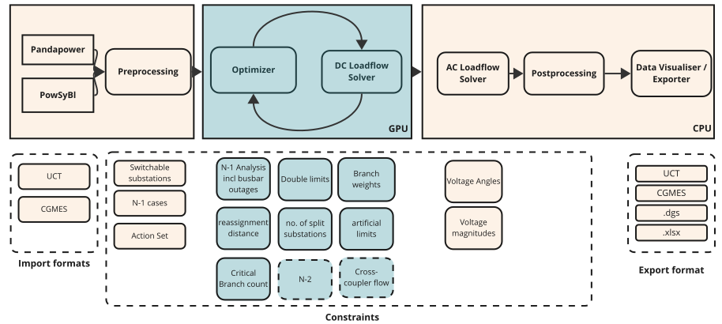

# How it works

A ToOp run passes through three stages. Each one is a worker that can also run on its own:

1. **Importer** – reads a UCTE or CGMES grid, builds the masks and the N-1 definition, and prepares everything the GPU needs.
2. **DC-Optimizer** – a genetic, quality-diversity search on the GPU; every candidate topology is scored with a batched DC load flow.
3. **AC-Validator** – picks the most promising candidates and checks them with a full AC contingency analysis before they reach the operator.

For a visual, step-by-step tour of these stages – what every component does and which package implements it – take the interactive tour. The C4 architecture model behind it is described in the [architecture overview](architecture/README.md).

[▶ Take the interactive tour](tour/index.html){ .md-button .md-button--primary }

ToOp ships no GUI or system integration: you drive it from Python or through Kafka commands, see [Usage](usage.md).

## High-level architecture

ToOp takes operational grid files (for example UCTE or CGMES) as input. They are imported with open-source libraries and normalized into a processed grid folder: the importer writes the backend grid snapshot together with masks, loadflow parameters and topology metadata, and the DC preprocessing adds `static_information.hdf5`, `action_set.json` and the final contingency definition.

The preprocessed files are then optimized in a GPU-native set-up: the genetic optimizer together with the GPU-based load flow solver. The results are kept as a Pareto front – a set of solutions where none can be improved in one objective without becoming worse in another. These candidates are validated and filtered with an AC power flow. Finally, a frontend shows the results, so that an operator can review the proposed actions and export the ones they accept to other systems.

## The GPU-based DC load flow solver

The GPU-based DC load flow solver computes a large number of *similar* DC load flows very quickly. It batches over the following dimensions – the workload must not change in anything else:

* branch topology (the assignment of branches to busbar A or B)
* injection topology (the assignment of injections to busbar A or B)
* branch outages

Under the hood it uses PTDF, (G)LODF and BSDF methods. If your workflow fits these requirements, as topology optimization does, the solver can help you too. Read more in the [DC solver section](dc_solver/intro.md).
