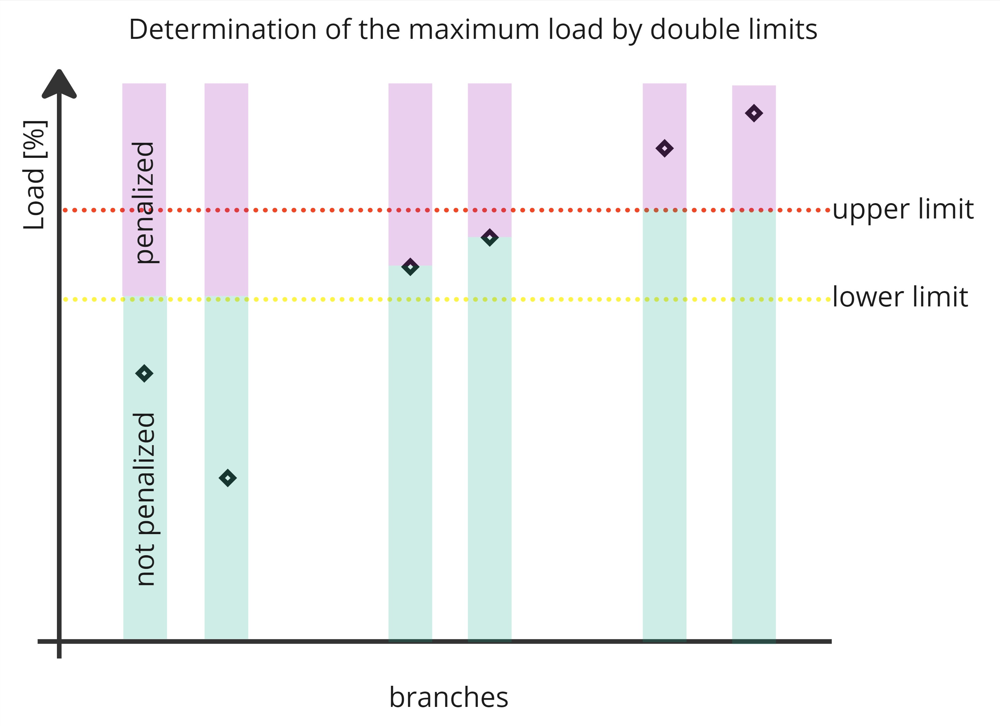

# Artificial limits

The importer sets the optimization limit of every monitored branch as the operational limits `artificial_limit_n_0` and `artificial_limit_n_1`. The optimizer measures overloads against these limits instead of the physical limits. They are derived from the physical limit, the worst current of the branch, the branch role (optimized or non-worsening) and the `double_limits` parameter.

## Double limits parameter

`double_limits` ([`DoubleLimitsSetpoint`][toop_engine_interfaces.messages.preprocess.preprocess_commands.DoubleLimitsSetpoint]) is part of the importer parameters. It has three factors relative to the physical limit:

| Field | Meaning | Default |
|---|---|---|
| `lower` | Optimized branches below this share of the physical limit may be loaded up to it. | 1.0 |
| `upper` | Optimized branches above this share of the physical limit are reduced to it. | 1.0 |
| `minimum_lower_physical_non_worsening_limit` | Smallest artificial limit of non-worsening branches. Keeps branches with a low or zero flow above 0. | 0.4 |

`lower` must not exceed `upper`. With the defaults, optimized branches get their physical limit. Non-worsening branches are limited to their worst current or to the `minimum_lower_physical_non_worsening_limit` physical limit.

{width=400}

## Inputs

The limits are computed after the AC security analysis of the import, for every branch side and separately for the base case (`n_0`) and the contingencies (`n_1`).

| Input | N-0 | N-1 |
|---|---|---|
| Flow | Absolute current in the base case. | Largest absolute current over all converged contingencies. The N-0 current if the branch has no N-1 result. |
| Physical limit | `permanent_limit`, or `loadflow_based_n_0` if the importer created it. | `N-1`, or `loadflow_based_n_1` if the importer created it. The N-0 limit if the branch has no N-1 limit. |
| Role | `optimized` or `non_worsening` of the monitored element in the N-1 definition. | Same. |

## Artificial limit by branch role

The artificial limit depends on the two flags `optimized` and `non_worsening` of the branch, its worst current and the physical limit. Example with a physical limit of 1000 A, `lower` 0.8, `upper` 0.9 and `minimum_lower_physical_non_worsening_limit` 0.4, so the lower limit is 800 A, the upper limit 900 A and the minimum non-worsening limit 400 A:

| Branch | Optimized | Non-worsening | Worst current | Artificial limit | Effect |
|---|---|---|---|---|---|
| A | true | false | 500 A | 800 A | Below the lower limit: `lower` times the physical limit. May be loaded up to the lower limit. |
| B | true | false | 850 A | 850 A | Between limits: loading must not get worse. |
| C | true | false | 1100 A | 900 A | Above the upper limit: `upper` times the physical limit. The current must be reduced to the upper limit. |
| D | true | true | 1100 A | 1000 A | Overloaded: the physical limit. `lower` and `upper` are ignored. |
| E | true | true | 700 A | 700 A | Not overloaded: `lower` and `upper` are ignored. |
| F | true | true | 200 A | 400 A | Not overloaded: the minimum non-worsening limit is the lowest limit, loading is allowed to increase to this `minimum_lower_physical_non_worsening_limit`. |
| G | false | true | 1800 A | 1800 A | Overloaded and non-worsening: loading must not be increased. |
| H | false | true | 500 A | 500 A | Not overloaded and non-worsening: loading must not be increased. |
| I | false | true | 200 A | 400 A | Not overloaded, non-worsening and below min lower physical limit: loading may increase to `minimum_lower_physical_non_worsening_limit`. |
| J | false | false | 700 A | none | Not monitored. |

Branches without a worst current or a physical limit get no artificial limit. The importer never sets both flags, branches D, E and F show the result if both are set.

## Written limits

- Limits are written for lines, two-winding transformers and tie lines. Three-winding transformers are already replaced by their legs.
- The limit name is `artificial_limit_n_0` or `artificial_limit_n_1`, with the acceptable duration 100 and 200.
- A new limit replaces an existing limit of the same element, side and name. The limit group of the physical limit is kept.
- A tie line is handled as one branch: its flow is the larger current of both sides, its physical limit the smaller limit of both sides. The limit is written on both boundary lines.

## Use in the optimizer

- The AC contingency analysis reports the metrics `*_artificial_limit_n_0` and `*_artificial_limit_n_1` next to the metrics against the permanent limit, see [Metrics](../../topology_optimizer/metrics.md). The importer fills `overload_energy_artificial_limit_n_0` and `overload_energy_artificial_limit_n_1` in the import statistics.
- The DC solver reads `artificial_limit_n_0` as `max_mw_flow` and `artificial_limit_n_1` as `max_mw_flow_n_1`. The currents are converted to MW with the voltage of the limit side. Branches without an artificial limit get 99999 MW. All DC overload metrics use these limits.

Results computed against the physical limits are not comparable with results against the artificial limits.
