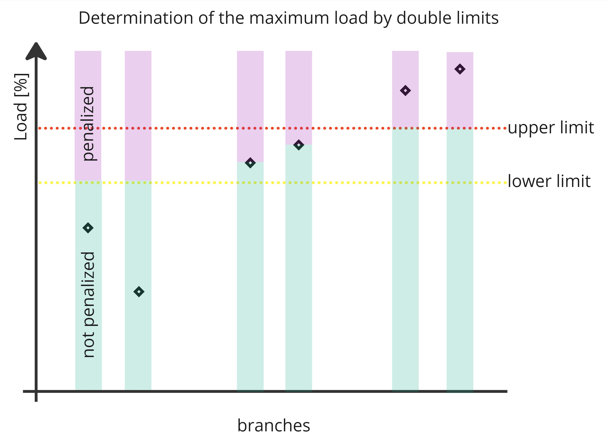
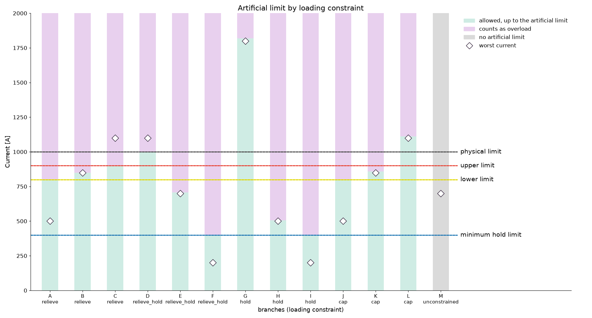

# Artificial limits

The importer sets the optimization limit of every monitored branch as the operational limits `artificial_limit_n_0` and `artificial_limit_n_1`. The optimizer measures overloads against these limits instead of the physical limits. They are derived from the physical limit, the worst current of the branch, the loading constraint of the branch (`LoadingConstraint`) and the `double_limits` parameter.

## Double limits parameter

`double_limits` ([`DoubleLimits`][toop_engine_interfaces.messages.preprocess.preprocess_commands.DoubleLimits]) is part of the importer parameters. It has four fields. Three are factors relative to the physical limit, `hold_margin` is relative to the worst current:

| Field | Meaning | Default |
|---|---|---|
| `lower` | Relieve and cap branches below this share of the physical limit may be loaded up to it. | 1.0 |
| `upper` | Relieve branches above this share of the physical limit are reduced to it. | 1.0 |
| `minimum_hold_limit` | Smallest artificial limit of hold branches. Keeps branches with a low or zero flow above 0. | 0.4 |
| `hold_margin` | Margin added to the worst current of hold branches, and of cap branches that are held. Prevents numerical noise (e.g. 1e-10 above the limit) from counting as an overload, which would add a full overload count penalty. | 0.01 |

`lower` must not exceed `upper`. With the defaults, relieve branches get their physical limit. Hold branches are limited to their worst current plus `hold_margin`, or to the `minimum_hold_limit` physical limit. For a `relieve_hold` branch, the margin never lifts the limit above the physical limit. Cap branches get the larger of the lower limit and their worst current plus `hold_margin`; `upper` and `minimum_hold_limit` do not apply to them.

{width=400}

## Inputs

The limits are computed after the AC security analysis of the import, for every branch side and separately for the base case (`n_0`) and the contingencies (`n_1`). The importer worker stores this analysis, with the new limits attached, as the initial loadflow.

| Input | N-0 | N-1 |
|---|---|---|
| Flow | Absolute current in the base case. | Largest absolute current over all converged contingencies. The N-0 current if the branch has no N-1 result. |
| Physical limit | `permanent_limit`, or `loadflow_based_n_0` if the importer created it. | `dacf_permanent_n_1`, or `loadflow_based_n_1` if the importer created it. The N-0 limit if the branch has no N-1 limit. |
| Loading constraint | `loading_constraint` of the monitored element in the N-1 definition. | Same. |

## Artificial limit by loading constraint

The artificial limit depends on the `loading_constraint` of the branch ([`LoadingConstraint`][toop_engine_interfaces.nminus1_definition.LoadingConstraint]), its worst current and the physical limit. Example with a physical limit of 1000 A, `lower` 0.8, `upper` 0.9 and `minimum_hold_limit` 0.4 and `hold_margin` 0.01, so the lower limit is 800 A, the upper limit 900 A and the minimum non-worsening limit 400 A:

| Branch | Loading constraint | Worst current | Artificial limit | Effect |
|---|---|---|---|---|
| A | `relieve` | 500 A | 800 A | Below the lower limit: `lower` times the physical limit. May be loaded up to the lower limit. |
| B | `relieve` | 850 A | 850 A | Between limits: loading must not get worse. |
| C | `relieve` | 1100 A | 900 A | Above the upper limit: `upper` times the physical limit. The current must be reduced to the upper limit. |
| D | `relieve_hold` | 1100 A | 1000 A | Overloaded: the physical limit. `lower` and `upper` are ignored. |
| E | `relieve_hold` | 700 A | 707 A | Not overloaded: `lower` and `upper` are ignored. The worst current plus `hold_margin`. |
| F | `relieve_hold` | 200 A | 400 A | Not overloaded: the minimum hold limit is the lowest limit, loading is allowed to increase to this `minimum_hold_limit`. |
| G | `hold` | 1800 A | 1818 A | Overloaded: loading must not be increased. |
| H | `hold` | 500 A | 505 A | Not overloaded: loading must not be increased beyond the margin. |
| I | `hold` | 200 A | 400 A | Not overloaded and below the minimum hold limit: loading may increase to `minimum_hold_limit`. |
| J | `cap` | 500 A | 800 A | Below the lower limit: `lower` times the physical limit. May be loaded up to the lower limit. |
| K | `cap` | 850 A | 858.5 A | Between limits: the worst current plus `hold_margin`. Loading must not be increased. |
| L | `cap` | 1100 A | 1111 A | Overloaded: the worst current plus `hold_margin`. Not healed, loading must not be increased. |
| M | `unconstrained` | 700 A | none | Monitored without a limit. |

{width=800}

Branches without a worst current or a physical limit get no artificial limit. The importer masks never produce the loading constraint `relieve_hold`; only an input N-1 definition can set it (branches D, E and F). The same holds for `cap` (branches J, K and L), which the masks cannot express. A branch that is not monitored gets no artificial limit either.

## Written limits

- Limits are written for lines, two-winding transformers and tie lines. Three-winding transformers are already replaced by their legs.
- The limit name is `artificial_limit_n_0` or `artificial_limit_n_1`, with the acceptable duration 100 and 200.
- A new limit replaces an existing limit of the same element, side and name. The limit group of the physical limit is kept.
- A tie line is handled as one branch: its flow is the larger current of both sides, its physical limit the smaller limit of both sides. The limit is written on both boundary lines.

## Use in the optimizer

- The AC contingency analysis reports the metrics `*_artificial_limit_n_0` and `*_artificial_limit_n_1` next to the metrics against the permanent limit, see [Metrics](../../topology_optimizer/metrics.md). The importer fills the AC overload currents `overload_current_artificial_limit_n_0` and `overload_current_artificial_limit_n_1` (in A) and the DC overload energies `overload_energy_artificial_dc_limit_n_0` and `overload_energy_artificial_dc_limit_n_1` (in MW) in the import statistics.
- The DC solver reads `artificial_limit_n_0` as `max_mw_flow` and `artificial_limit_n_1` as `max_mw_flow_n_1`. The currents are converted to MW with the voltage of the limit side. Branches without an artificial limit get 99999 MW. All DC overload metrics use these limits.

Results computed against the physical limits are not comparable with results against the artificial limits.
