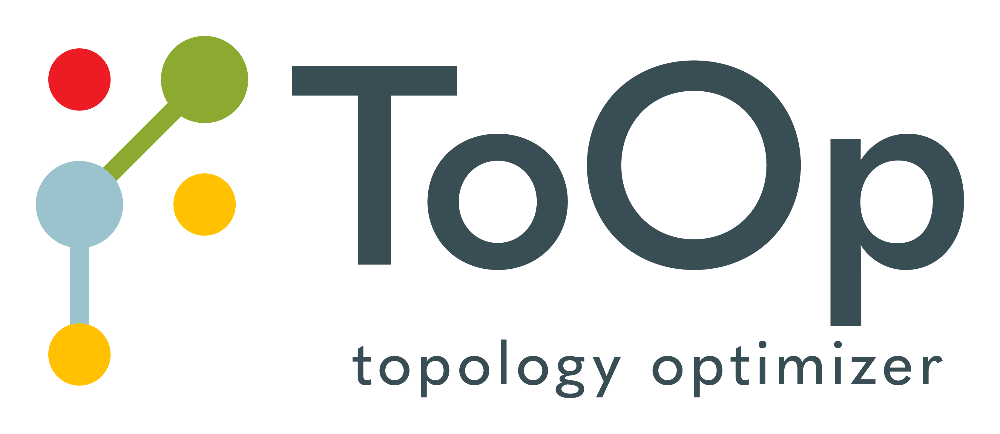
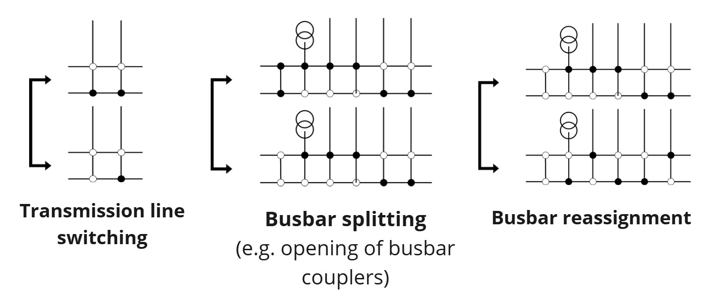
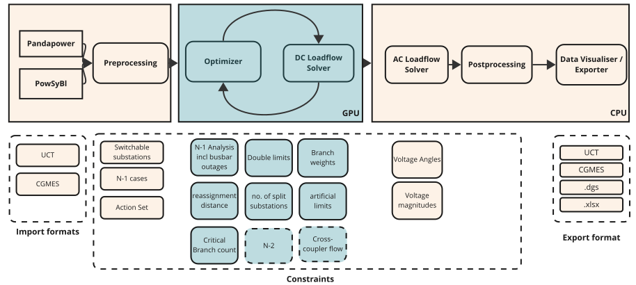

## Hello there 👋

Welcome to our ToOp (engine) repository at Elia Group.




## A short intro – what is ToOp about?

Electricity does not take the route we pick for it. It spreads over every line it can reach, simply following the laws of physics. On busy days some of these lines end up carrying more power than they safely can – grid operators call this *congestion*. The usual fix is *redispatch*: asking one power plant to produce less and another, somewhere else, to produce more. It works, but it is expensive, and it often means starting up plants that emit more CO₂.

ToOp, short for *topology optimisation*, looks for a cheaper and cleaner way out. Rather than changing who produces the electricity, it changes the layout of the grid itself – for example by switching off a line, or by splitting a substation so that it behaves like two separate junctions. Much like closing a street or opening a new junction in a city, these *topological actions* gently steer the power away from the lines that are full, and they cost next to nothing to carry out. ToOp searches through the many possible combinations and suggests the most promising ones to the operators in the control room, who always have the final say.

> Our goal: help grid operators relieve congestion with clever switching instead of costly redispatch – saving money and CO₂ along the way.

This repository holds the engine behind ToOp at Elia Group. It reads operational grid data through an importer, searches for good topologies in a fast DC optimisation stage, and double-checks the best candidates with a full AC validation. It also contains the GPU-based DC load flow solver that makes the search fast. Today ToOp considers transmission line switching, busbar splitting, busbar reassignment and linear tap optimisation of phase-shifting transformers (PSTs); for grids imported with PowSyBl, it can also optimise groups of PSTs together.



## About this repository
This repo builds the engine behind the topology optimization project ToOp at Elia Group. The standard workflow first normalizes a raw grid into a processed grid folder containing the backend grid snapshot, masks, loadflow parameters, topology metadata, and an initial contingency definition. The DC preprocessing stage then adds `static_information.hdf5`, `action_set.json`, `action_set_diffs.hdf5`, and the final `nminus1_definition.json` used by the solver, optimizer, and postprocessing. Note that this does NOT provide a GUI or system integration code, you are expected to interact with the module through either python or kafka commands. You can check the [paper](https://arxiv.org/abs/2501.17529) for a high level academic introduction.
Please check out our [full documentation](https://eliagroup.github.io/ToOp).


## Getting Started

If you want to get started with the engine, we highly recommend checking out our <!-- markdown-link-check-disable --> [example notebooks](https://github.com/eliagroup/ToOp/tree/main/notebooks). <!-- markdown-link-check-enable -->

### Prerequisites

If you want to contribute to this repository, we recommend using VS Code's Devcontainer Environment. This allows the developers to use the same environment to develop in.

For this setup, you need to install:
1. `uv`
2. `Python 3.14`
3. `Microsoft VS Code`
4. `Docker`

### Installation

You can follow our installation guide on our [Contributing page](./contribution_guide.md#local-development-setup).

### Usage

In order to understand the functionalities of this repo, please have a look at our examples in `notebooks/`.
There you can find several Jupyter notebooks that explain how to use the engine.
For example, you can import a grid file, build the preprocessing artifacts, and compute the DC loadflow using our GPU-based loadflow solver.
Or you can load an example grid, including the grouped-PST Powsybl example, and minimise the branch overload by running the topology optimizer.

You can also build the documentation and open it on your web browser by running
```bash
uv sync --all-groups
uv run mkdocs serve
```

---


### Useful resources
The following resources may be helpful to grasp the key concepts:

- [Quickstart](./quickstart.md): Grasp the basics and follow along examples. The first one take you through a DC loadflow computation using the [DC Solver package](./dc_solver/intro.md).
- [Usage](./usage.md): Learn about the two different ways to use this software, either via python or kafka.
- [Topology Optimizer](./topology_optimizer/intro.md): Understand the key concepts behind the topology optimizer.
- [Presentation ToOp](https://www.youtube.com/watch?v=XteDpNsX75A)  @ LF Energy 2025
- [Presentation ToOp](https://lfenergy.org/lf-energy-summit-recap-and-video-a-gpu-native-approach-on-tackling-grid-topology-optimization/) @ LF Energy 2024

**Note**: This project does not provide a GUI or system integration code.
You are expected to interact with the module through either python or kafka commands. This might come in the future if there is an interest from the community.

## High-level architecture


The topology optimizer takes as an input operational grid files (e.g. UCT, CGMES) which are imported by open-source libraries (PowSyBl, pandapower) and normalized into a processed grid folder. The importer stage writes the backend grid snapshot together with masks, loadflow parameters, and topology metadata; the DC preprocessing stage adds `static_information.hdf5`, `action_set.json`, and the final contingency definition. The pre-processed files are then optimized in a GPU-native set-up (optimizer + GPU-based load flow solver). The optimal results are stored as a pareto-front, so a set of all solutions that are "Pareto optimal". This means that no other solution exists that improves at least one objective without worsening another one. These results are then validated and filtered using an AC power flow. In the end the results are displayed in a frontend where an end user can review and evaluate the proposed actions. The proposed topological actions can then be exported to other systems.

For a step-by-step, interactive walk through this pipeline, from input to displayed results, with a sketch of what every component does and which package implements it, open the [pipeline explorer](architecture/pipeline_explorer.html).


#### Description the GPU-based DC load Flow solver
The GPU-based DC Load Flow solver serves the purpose of computing a large number of similar DC load flows in an
accelerated fashion. Currently the solver supports the following batch dimensions, i.e. the workload must not change
in anything other than these dimensions:
• Branch topology (assignment of branches to busbar A or B)
• Injection topology (assignment of injections to busbar A or B)
• Branch outages

Under the hood, it is using PTDF/(G)LODF/BSDF approaches to achieve this.
If your workflow suits these requirements like it is the case for topology optimization, this solver can help you out.


## Roadmap

Next to some smaller improvements, current work focuses on broadening controllable asset support, improving preprocessing fidelity, and hardening the end-to-end optimization workflow:
- Support of a wider range of asset topologies by refactoring the our abstraction layer
- Support of optimization of non-linear and/or asymmetric phase-shifting transformers

We will work on sharing a more high-level roadmap in the future.


## Let us work together

We strongly believe that through joint development,  collaboration and integration into other tools, we can jointly build an open-source topology optimizer that is fast, provides accurate recommendations and can be used by different TSOs to reduce grid congestion. Topology optimization works best when holistically applied to the grid and the different operational constraints from different TSOs are considered. This is why we invite you to share your feedback, constraints and your approaches so that we can jointly improve ToOp.

In addition, we also see the opportunity that ToOp can be combined with other open-source tools. If you have ideas, reach out us.

We invite you to test it, ask questions and provide feedback to us. And if you like it, we invite you to contribute to the development. We are looking forward to hearing from you.

## Finding help

If you require help with using this package, your first point of contact is <a href="mailto:ToOp@eliagroup.eu">ToOp@eliagroup.eu</a>.


## Contributing

Please have a look at our [Contribution Guide](contribution_guide.md).


## License

Distributed under MPL 2.0.<!-- markdown-link-check-disable --> See [LICENSE](https://github.com/eliagroup/ToOp/blob/main/LICENSE).<!-- markdown-link-check-enable -->

## Citation

If you use our work in scientific research, please cite [our paper on load flow solving](https://arxiv.org/abs/2501.17529) and soon also the work on the optimizer architecture, which is to be released soon.


## Contact


Team – [ToOp](mailto:ToOp@eliagroup.eu)

<!-- markdown-link-check-disable -->
<a href="https://www.eliagroup.eu/"></a>
<!-- markdown-link-check-enable -->

---

## Acknowledgments

We credit the authors of JAX.
```
@software{jax2018github,
  author = {James Bradbury and Roy Frostig and Peter Hawkins and Matthew James Johnson and Chris Leary and Dougal Maclaurin and George Necula and Adam Paszke and Jake Vander{P}las and Skye Wanderman-{M}ilne and Qiao Zhang},
  title = {{JAX}: composable transformations of {P}ython+{N}um{P}y programs},
  url = {http://github.com/jax-ml/jax},
  version = {0.3.13},
  year = {2018},
}
```
