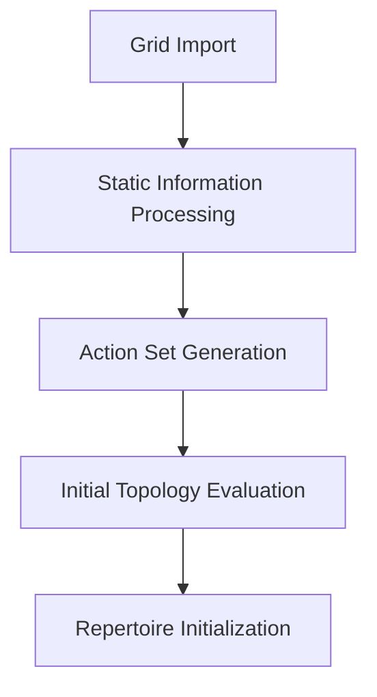
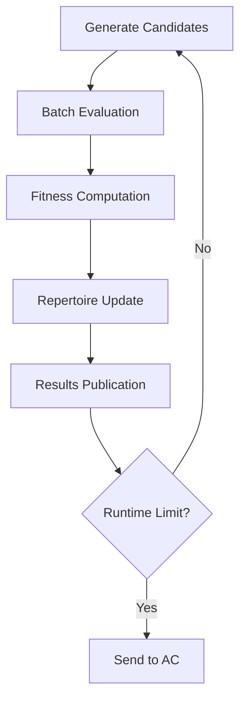
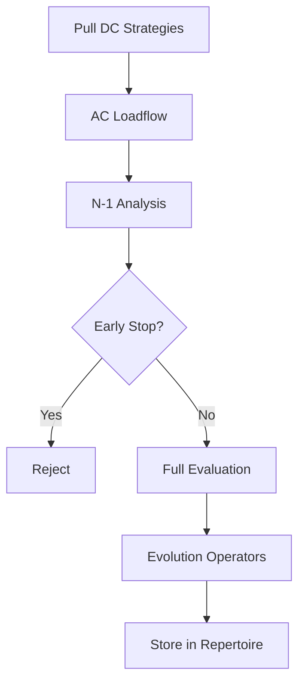

# Under the Hood: Optimization Workflow

!!! Work-in-progress

    We work on a deeper explanation of the underlying genetic algorithm.
    Thank you for your patience.   

## 1. Initialization Phase

1. **Grid preprocessing** using the importer package to create [`StaticInformation`](../dc_solver/preprocessing.md) objects
2. **Action enumeration** generating feasible substation switching combinations
3. **Initial evaluation** establishing baseline metrics for the unsplit grid topology

## 2. DC Optimization Loop

The DC stage uses a quality-diversity approach:

- **Population diversity**: Maintained across [descriptor](../glossary.md#repertoire-and-descriptor) dimensions (by default split substations and switching distance)
- **Parallel evaluation**: GPU-accelerated batch processing of topology candidates
- **Elite preservation**: Best solutions preserved in each repertoire cell
- **Continuous publication**: Promising topologies sent to AC stage via Kafka messaging

### How PST taps are optimized

Phase-shifting transformers (PSTs) are not switched on or off like lines. Each PST has a tap table, and every integer tap position sets the phase angle the transformer injects into the grid. Changing the tap redistributes the flow over the parallel paths around it, which is what makes PSTs useful for relieving overloads. ToOp treats the tap as one more gene of the genetic algorithm, but only when nodal-injection optimization is enabled (`enable_nodal_inj_optim`, off by default). The same steps apply to the linear and the non-linear case; they only differ in how the tap is evaluated.

**Linear PSTs.** During import, a PST is classified as linear when its tap changes nothing but the phase angle: impedance, ratio and shunt values stay constant across the tap table (for PowSyBl, the phase shifter is linear if the tap-changer parameters are constant; for pandapower, only tap changers of type `Ideal` qualify). The DC flow model handles these PSTs with phase-shift sensitivities that are added next to the usual injection sensitivities. The solver writes the angle of the current tap into the nodal injections, so evaluating a tap combination is a linear update of the branch flows and needs no extra solve per tap.

**Non-linear PSTs.** If a tap also changes the susceptance of the transformer, the solver keeps a per-tap susceptance table for that PST. When a candidate sets a tap, the affected branch susceptances are updated from this table before the DC flows are computed. The evaluation is still a DC load flow, so the search stays fast, but it follows the real tap behaviour more closely than a constant-susceptance model.

**Searching over taps.** The genetic algorithm proposes tap changes as small discrete steps: a Gaussian step around the current tap, applied with a configurable probability (`pst_mutation_sigma`, `pst_mutation_probability`), and clipped to the valid tap range of each PST. Taps are integers; the search does not compute a continuous optimum. Candidates therefore carry a tap vector together with their switching actions, and the repertoire metrics report how far taps moved from their starting positions (`pst_switching_distance`, `pst_activated`).

**Grouped PSTs.** Parallel PSTs that connect the same buses with matching parameters can be optimized as one group that shares a single tap delta (`enable_parallel_pst_group_optim`). Grouping is only available for PowSyBl grids and requires nodal-injection optimization. See [parallel PST grouping](../dc_solver/preprocessing.md#parallel-pst-grouping) for the detection rules.

**AC validation.** The AC stage does not search over taps. For each candidate it sets the tap positions as setpoints on the grid model and runs the AC load flow with them, so the final decision reflects the AC behaviour of the chosen taps. The DC stage's tap choice is therefore a proposal that the AC stage checks.

Known limitations: taps are integer positions only, the brute-force DC optimizer does not change PST taps, and pandapower grids use a constant susceptance for all taps.

## 3. AC Validation and Refinement

The AC stage provides high-fidelity validation:

- **Strategy pulling**: Intelligent selection from DC repertoire using [filtering strategies](ac/select_strategy.md)
- **AC validation**: Full power flow with reactive power and voltage constraints
- **[Early stopping](ac/early_stopping.md)**: Efficient rejection on a merged critical-contingency subset
- **[AC loop](ac/ac_loop.md)**: Worker-side batching, survivor buffering, and remaining-contingency flushing

## 4. Communication Architecture

The optimizers use **Apache Kafka** for asynchronous, scalable communication:

- **Commands topic**: Optimization start/stop commands with grid file references
- **Results topic**: Topology candidates with metrics and loadflow references  
- **Heartbeats topic**: Status monitoring and performance statistics
